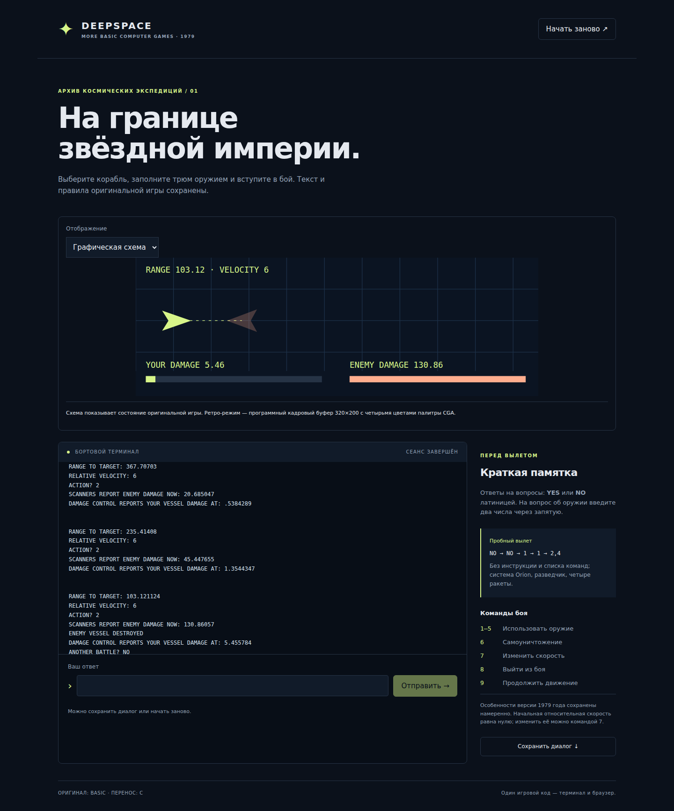

# Deepspace: перенос BASIC → C

Публичный репозиторий: https://github.com/IPloshadka/deepspace

**Уточнённые требования:** [матрица соответствия и ограничения](docs/REQUIREMENTS.md). Категории ОС: Unix, Windows, Web. Процессоры: x86 32-bit / x86_64 64-bit. Все четыре задания [проверки от 26 ноября 2026](https://github.com/IPloshadka/deepspace/actions/runs/45747034847) прошли: Linux 32, Linux 64, Windows и Web. Подробные доказательства — [отчёт](evidence/VERIFIED-2026-11-26.md).

Текстовый космический бой из **More BASIC Computer Games (1979)**. Оригинальный английский текст, формулы и переходы сохранены. Один движок на C работает в терминале и в браузере через WebAssembly. Браузерная оболочка содержит русские подсказки.

Пример настоящего диалога: [победа над противником](tests/expected/enemy_destroyed.txt). Скриншоты реального Chromium: [современная графика](evidence/screenshots/desktop.png), [ретро-режим](evidence/screenshots/retro.png), [мобильный экран](evidence/screenshots/touch.png).

## Быстрый запуск на Mac в VS Code

Распакуйте архив, откройте **папку deepspace целиком** через File → Open Folder. Откройте Terminal → New Terminal. Все команды ниже выполняются из папки с `Makefile`.

```sh
make
make run
```

Если компилятор не установлен, выполните `xcode-select --install`, завершите установку и повторите команды. VS Code — редактор; программу собирает Clang, установленный с Command Line Tools. Если у вас именно Visual Studio, а не VS Code, эти же команды можно выполнить в обычном терминале macOS.

Для пробной игры вводите **по одной строке**, после каждой нажимая Enter:

```text
NO
NO
1
1
2,4
7
6
2
2
2
2
NO
```

Это отказ от инструкции и таблицы команд, система Orion, разведчик, четыре ракеты, изменение скорости на 6, четыре выстрела и отказ от нового боя. В эталонной семантике этот сценарий приводит к победе.

**Терминальная программа не открывает отдельное окно.** Игра идёт там же, где введена команда. Для версии с интерфейсом в браузере:

```sh
make serve
```

Откройте <http://localhost:8000>. Сервер остановить: Ctrl+C. Готовый `web/deepspace.wasm` уже включён: для этого запуска не нужны Zig, Lua или пересборка WebAssembly. Если `python3` не найден, установите Python 3 с python.org. Двойной щелчок по `index.html` не заменяет сервер: браузер ограничивает загрузку Wasm через `file://`.

## Проверка запуска именно 32-битной игры

В универсальном Linux-архиве есть `bin/deepspace-linux-x86`. Из папки deepspace в JSLinux выполните:

```sh
sh check-linux-32.sh
```

Ожидаются строка `architecture=x86 pointer_bits=32 byte_order=little`, сообщение о победе и `PASS`. Это запуск **самой 32-битной игры**, даже если `uname -m` показывает x86_64. Для интерактивного боя:

```sh
./bin/deepspace-linux-x86
```

Если ядро вашей JSLinux не поддерживает исполнение 32-битных ELF, оно сообщит ошибку; не считайте такой запуск успешным. Автоматический Linux 32-bit job в GitHub Actions проверяет ту же возможность на Linux с поддержкой IA32. Из клонированного репозитория без архива готовый файл можно скачать из артефакта `linux-32` или собрать на обычном Linux с GCC multilib:

```sh
make CC="gcc -m32 -msse2 -mfpmath=sse -static"
python3 tests/check_elf.py build/deepspace 32
sh check-linux-32.sh build/deepspace
```

## Быстрая проверка в JSLinux (x86_64 или x86)

В обновлённом комплекте достаточно выполнить из папки deepspace:

```sh
sh check-smoke.sh
./build/deepspace
```

Скрипт сам собирает программу имеющимся GCC/cc и проверяет победу, поражение, самоуничтожение и повторный бой. Четыре строки PASS означают успешные базовые проверки на **вашей** системе. Они не заменяют полное сравнение с BASIC. Только сборка: `sh build.sh`. Так не нужно вручную набирать флаги `-O2` и `-o`, где O/o — буквы, а не нули.

Универсальный архив `deepspace-linux.tar.gz` содержит исходники и готовые файлы для обеих архитектур. Команда `uname -m` показывает архитектуру: для `x86_64` запасной готовый файл — `bin/deepspace-linux`, для `i386`/`i486`/`i586`/`i686` — `bin/deepspace-linux-x86`. Предпочтителен запуск скрипта сборки. Готовые файлы в обновлённых архивах взяты из успешных Linux 32/64 заданий CI: они действительно запускались и прошли тесты.

```sh
tar -xzf deepspace-linux.tar.gz
cd deepspace
sh check-smoke.sh
./build/deepspace
```

## Linux: прежний архив x86 и ручная сборка

В комплекте поставки есть отдельный архив **deepspace-linux-x86.tar.gz**. В JSLinux загрузите его кнопкой передачи файла с компьютера, затем в терминале перейдите в каталог загрузки. В разных версиях JSLinux это может быть текущий каталог или `/tmp`; проверьте `pwd`, `ls` и `ls /tmp`.

```sh
# Выполняйте из каталога, в котором лежит загруженный архив:
tar -xzf deepspace-linux-x86.tar.gz
cd deepspace
make
./build/deepspace
```

Если `make` отсутствует, достаточно уже обнаруженного у вас GCC:

```sh
mkdir -p build
gcc -std=c99 -O2 -ffp-contract=off src/game.c src/cli.c -lm -o build/deepspace
./build/deepspace
```

Если компилятор недоступен, в отдельном Linux-архиве есть статический 32-битный исполняемый файл:

```sh
chmod +x bin/deepspace-linux-x86
./bin/deepspace-linux-x86
```

В обновлённом архиве он собран GCC для x86 Linux со статической glibc и проверен на Ubuntu; запуск непосредственно в вашей JSLinux проверяется командой `sh check-linux-32.sh`. Для обычного 64-битного Linux можно собрать из тех же исходников командой `make`. Для игры не нужны Python, интернет, SDL, Lua или графическая система. Python 3 нужен только для тестов/веб-сервера. Загружайте архив до перезапуска виртуальной машины: сохранность файлов между сеансами зависит от JSLinux.

## Windows

В отдельном архиве готовых программ есть `deepspace-windows.exe` для Windows x64. Запускайте его из PowerShell: `./deepspace-windows.exe`. Файл собран MSVC и проверен на Windows Server 2022: модульные тесты, фаззинг и 23 диалога прошли.

Для сборки через `make` установите MSYS2, откройте **UCRT64**, установите `make` и `mingw-w64-ucrt-x86_64-gcc`, перейдите в папку проекта и выполните `make`. Для тестов дополнительно нужен Python 3. VS Code может использовать этот терминал. Проект `.sln` для Visual Studio не требуется; основной способ сборки по условию проекта — Makefile.

## Графика и способы ввода

В веб-версии можно выбрать графическую схему боя, ретро-оформление или только терминал. Схема читает дистанцию, скорость и повреждения из C-ядра. Формулы и ход оригинальной игры не менялись. Контекстные кнопки позволяют пройти игру мышью или касаниями без набора текста; клавиатурный ввод сохранён. Ретро-режим использует программный кадровый буфер 320×200 и четыре цвета палитры CGA. Это не отдельная ретро-ОС и не аппаратный адаптер CGA.

## Проверки и сборка других вариантов

```sh
make test-core      # модульные проверки и независимая модель боезапаса
make test-fuzz      # 2000 seed / 6000 сессий, фаззинг и свойства
make test           # 23 диалога, Python 3
make test-page      # обработчики веб-страницы с имитацией DOM, нужен Node.js
make test-web       # те же 23 диалога для готового Wasm, Python 3 + Node.js
make reference-test VINTBAS=/полный/путь/к/vintbas
```

Последняя команда дополнительно запускает исходный BASIC в **Vintage BASIC 1.0.3**. Сам интерпретатор не включён; ссылка и описание эталона — в [COMPATIBILITY](docs/COMPATIBILITY.md). Обычный `make test` сравнивает с уже записанными настоящими эталонными логами.

Для пересборки WebAssembly и кросс-компиляции нужен **Zig 0.14.1** с ziglang.org, доступный как `zig`:

```sh
make web
make windows
make linux
make linux-x86
# Если Zig не в PATH: make web ZIG=/полный/путь/к/zig
```

Эти команды выполняют кросс-сборку. Отдельно GitHub Actions действительно запускает Linux ELF32/ELF64, Windows EXE и веб-страницу в Chromium. Все задания прошли. Локально также проверены macOS ARM64 и Wasm в Node.js. Подробности — [актуальный отчёт проверки](evidence/VERIFIED-2026-11-26.md).

## Где смотреть код и что рассказывать

| Файл | Содержание |
|---|---|
| `original/deepspace.bas` | Неизменённая исходная игра на BASIC |
| `src/game.c` | Правила игры на C; `case 1200` соответствует строке BASIC 1200 |
| `src/deepspace.h` | Граница между движком и оболочкой |
| `src/cli.c` | Ввод с клавиатуры и вывод в терминал |
| `src/web_bridge.c` | Буфер ввода для WebAssembly |
| `web/engine.mjs` | Связь браузера/Node.js с тем же C-движком |
| `web/app.mjs`, `web/index.html`, `web/style.css` | Браузерные элементы управления и оформление |
| `tools/translate.py` | Узкий переводчик конкретного оригинала в C; для сборки не нужен |
| `tests/dialogues`, `tests/expected` | Ввод и эталонный вывод для проверки |
| `Makefile` | Команды сборки и тестов |

Начните с [объяснения для защиты](docs/DEFENSE.md), затем прочитайте [особенности совместимости](docs/COMPATIBILITY.md). Lua здесь не используется: он не нужен для этого порта. Практики 4 и 5 в этот комплект не включены.

## Публикация и сдача

Публичный репозиторий: [IPloshadka/deepspace](https://github.com/IPloshadka/deepspace). Для проверки версии и запусков используйте вкладки Commits и Actions. Для сохранения истории используйте отдельный файл `deepspace-history.bundle` и [инструкцию публикации](docs/PUBLISH.md). Простая загрузка ZIP на GitHub не переносит историю коммитов.

Оригинал принадлежит его авторам; источники указаны в [SOURCE.md](original/SOURCE.md). Перенос не меняет права на оригинальный текст. Лицензия, разрешающая произвольное использование всего комплекта, здесь не заявляется.

Итоговая проверка от 26 ноября 2026: [результаты, контрольные суммы и ограничения](evidence/VERIFIED-2026-11-26.md). Предыдущий аудит сохранён как [исторический документ](docs/AUDIT.md).

### Windows: сборка стандартным MSVC

Из Developer PowerShell Visual Studio с CMake и компонентами C++:

```powershell
cmake -S . -B build -A x64
cmake --build build --config Release
ctest --test-dir build -C Release --output-on-failure
./build/Release/deepspace.exe
```

Автоматические проверки Linux 32/64, Windows и реального браузера описаны в `.github/workflows/verify.yml`. Артефакты содержат готовые Linux/Windows-файлы, логи диалогов и браузерные скриншоты.

## Вид работающей веб-версии


